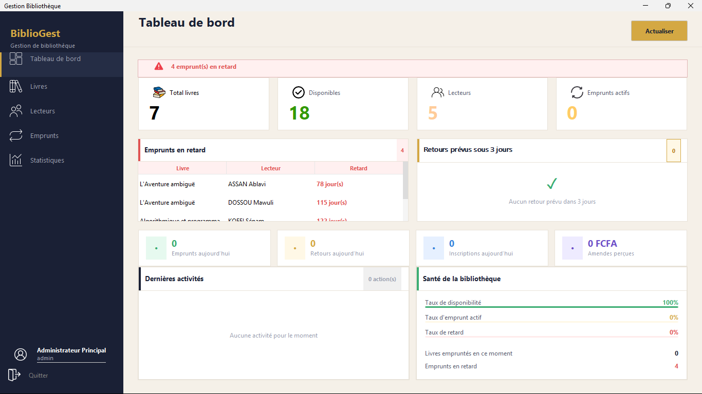

# BiblioGest

Application de bureau (Windows) pour gérer une bibliothèque : catalogue de livres, lecteurs, emprunts, retours, amendes, statistiques et états imprimables.



## Le problème

Beaucoup de petites bibliothèques gèrent leurs emprunts sur papier : livres perdus, retards non suivis, aucune vision de l'activité. BiblioGest centralise tout dans une seule application.

## Fonctionnalités

- **Livres** : ajout, modification, suppression, recherche, filtre par catégorie, nombre d'exemplaires total et disponible, détection des doublons.
- **Lecteurs** : inscription, modification, recherche, historique des emprunts, contrôle des doublons (nom, prénom, téléphone).
- **Emprunts** : durée par défaut de 14 jours, **3 emprunts actifs maximum par lecteur**, un lecteur ne peut pas emprunter deux fois le même livre en même temps.
- **Retours et amendes** : 100 F par jour de retard, plus un supplément si le livre est rendu usé (500 F) ou abîmé (2 000 F).
- **Tableau de bord** : emprunts et retours du jour, amendes du jour, emprunts actifs, retards.
- **Statistiques** par période : livres et lecteurs les plus actifs, rapport PDF (JasperReports).
- **États et exports** : listes de livres, lecteurs, emprunts, historique, rapport des retards ; export CSV lisible dans Excel.
- Écran de connexion avec identifiant et mot de passe.

## Stack

Java 8 · Swing (interfaces dessinées avec NetBeans) · FlatLaf (thème) · MySQL / MariaDB via JDBC · JasperReports, iText, JFreeChart · packaging avec Ant (NetBeans) et installeur Inno Setup.

## Architecture

Application en couches :

```
src/models/   objets métier (Livre, Lecteur, Emprunt, Utilisateur)
src/dao/      accès à la base (un DAO par entité, requêtes préparées)
src/views/    interfaces Swing
src/utils/    états et exports
src/reports/  modèle de rapport JasperReports
lib/          bibliothèques .jar nécessaires
```

## Installation pour le développement

Prérequis : JDK 8 ou plus, NetBeans, MySQL ou MariaDB (XAMPP convient).

1. Créer la base `biblioapp` puis importer `database/biblioapp.sql`.
2. La connexion est dans `src/dao/Connexion.java` (par défaut : `localhost:3306`, utilisateur `root`, mot de passe vide).
3. Ouvrir le dossier dans NetBeans (*File → Open Project*). Les `.jar` du dossier `lib/` sont déjà référencés.
4. Lancer le projet : la classe principale est `views.MainFrame`.
5. Créer un premier utilisateur dans la table `utilisateur` pour pouvoir vous connecter.

## Utilisation sans développement

Télécharger `BiblioGest_Setup_v1.0.exe` dans la page [Releases](https://github.com/clever75/BiblioGest/releases) et lancer l'installeur. MySQL doit tourner sur la machine.

## Ce que j'ai appris

- Concevoir une interface de bureau ergonomique avec Swing.
- Séparer l'interface, la logique métier et l'accès aux données.
- Traduire des règles métier (limites d'emprunt, amendes) en code vérifiable.
- Produire des états PDF et des exports, et empaqueter une application Java pour Windows.

## Limites connues et pistes d'amélioration

- Les mots de passe sont stockés en clair dans la base : à remplacer par un hachage (BCrypt). C'est la première amélioration prévue.
- Identifiants de base codés en dur dans `Connexion.java` : à déplacer dans un fichier de configuration.
- Pas de tests automatisés.

## Contexte

Projet réalisé en 2026 dans le cadre du BTS en développement d'applications à DEFITECH (Lomé).

**Auteur** : ASSAN Ablavi Clever, [GitHub](https://github.com/clever75)

